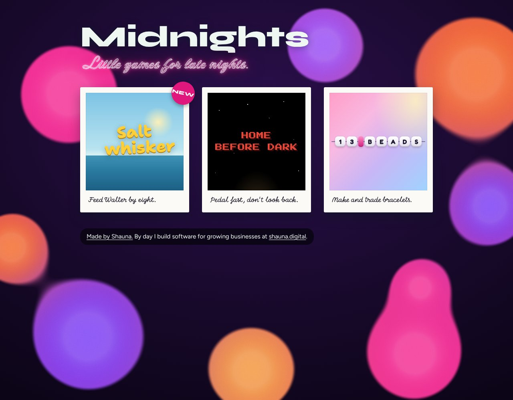

# Games

Little browser games for late nights. This repository is the home page that ties them together.

**▶ Play: [shauna.digital/games](https://shauna.digital/games/)**

| Game | What it is |
|---|---|
| [Shoreline](https://shauna.digital/games/shoreline/) | Drive an off-roader around a tiny tropical island, bowl with tiki pins and hunt for shells. ([repo](https://github.com/shaunadigital/shoreline)) |
| [TropiChop](https://shauna.digital/games/tropichop/) | Chop flying Hawaiian fruit and dodge Aunty's slippah and the wana. ([repo](https://github.com/shaunagits/tropichop)) |
| [13 Beads](https://shauna.digital/games/13-beads/) | String a friendship bracelet in 3D, spell a phrase, and hang it on your wall. ([repo](https://github.com/shaunagits/13-beads)) |
| [Home Before Dark](https://shauna.digital/games/homebeforedark/) | Pedal fast. Don't look back. |
| [Saltwhisker](https://shauna.digital/games/saltwhisker/) | Walter, a tuxedo cat in a yellow sou'wester, fishes off a pier for his dinner. ([repo](https://github.com/shaunagits/saltwhisker)) |

## How it is set up

- **Since 2026-11-02 the public address is `shauna.digital/games/<game>/`** (Shauna: `games.shauna.digital` was hard to type; browsers often searched for it). The shauna.digital Netlify site shows each game straight from its own Vercel project (rules in that repo's `netlify.toml`), and `/games/` shows this page from `games-lac-rho.vercel.app`. `games.shauna.digital` now redirects every path to the same path under `shauna.digital/games/` (first rule in `vercel.json`). The rewrites below are kept but only matter if that redirect is removed. To add a game, also add its rule to shauna.digital's `netlify.toml`. Shauna decided to keep this page for now (2026-11-02).

- This repository is a plain static site: `index.html` plus `vercel.json`. There is no build step and no framework.
- Hosting: Vercel project `games` (team `shaunagits-projects`), deployed automatically from the `main` branch. Pushing to `main` updates the live site.
- Domain: `games.shauna.digital` is attached to that Vercel project. DNS for `shauna.digital` is managed at Namecheap, where a CNAME record for the host `games` points to Vercel.
- Each game lives in its own repository and its own Vercel project. This site mounts a game under a path using a rewrite in `vercel.json`, so the game appears at `games.shauna.digital/<path>` without being copied here.

## Games mounted here

| Path | Repository | Vercel project | Address it forwards to |
|---|---|---|---|
| `/tropichop` | `shaunagits/tropichop` | `tropichop` | `https://tropichop.vercel.app` |
| `/13-beads` | `shaunagits/13-beads` | `13-beads` | `https://13-beads.vercel.app` |
| `/homebeforedark` | `shaunagits/homebeforedark` | `homebeforedark` | `https://homebeforedark.vercel.app` |
| `/saltwhisker` | `shaunagits/saltwhisker` | `saltwhisker` | `https://saltwhisker.vercel.app` |
| `/shoreline` | `shaunadigital/shoreline` | `shoreline` | `https://shoreline-psi.vercel.app` (the plain `shoreline.vercel.app` name was taken) |

## Add a game

1. Deploy the game as its own Vercel project. It must use relative asset paths so it works under a subpath (for a Vite project, set `base: './'`).
2. In `vercel.json`, add three rules for its path. All three are needed:
   - a redirect from `/<path>` to `/<path>/`, so relative asset paths resolve correctly;
   - a rewrite for `/<path>/` itself (the wildcard rule does not match the bare folder path);
   - a rewrite for `/<path>/:path*`.
3. Add a card for it at the top of the list in `index.html`, linking to `/<path>/`, and move the "New" sticker to it.
4. Add a row to the table above.
5. Push to `main`, then check the home page, `/<path>`, and that the game's script files load.

## Things to know

- A game saves player data per web address. Data saved at a game's own `vercel.app` address does not appear at `games.shauna.digital/<path>`.
- Home page design (updated 2026-10-17): title "Midnights" in Syne, a flickering pink neon tagline "Little games for late nights." (Neonderthaw), straight polaroid game cards with no captions (removed 2026-10-16), newest game first with a "New" sticker, a "Still developing." teaser card hanging last (restored 2026-10-25). Since 2026-10-17 the cards hang from wooden clips on strings of lights over Shauna's cork wall (`img/wall.webp`); the bulbs near a hovered or centered card glow in that game's color, and on phones the cards form one clothesline you swipe sideways. Colors and fonts are defined at the top of the `<style>` block in `index.html`; the strings and bulbs are drawn by the script at the end of the file.
- Fonts are self-hosted subsets in `fonts/` holding only the characters the page shows. After changing visible text, run `python3 tools/subset-fonts.py` (the script explains the steps).
- Link previews: `og.png` (1200 by 630) plus Open Graph and Twitter card tags in the page head. Regenerate the image when the cards change.
- All artwork is original. No artist names, logos, album artwork, or lyrics.

---

Built with ♥ by [shauna.digital](https://shauna.digital)

## Feedback panel (2026-11-02)

`feedback.js` is one shared in-game feedback panel, served at `https://shauna.digital/games/feedback.js`. Every game loads it with `` and opens it from any element with a `data-feedback` attribute (or `GameFeedback.open({ ...details })` from code; Home Before Dark does this from its canvas pause menu).

- Asks for a 1 to 5 face rating, "What should I fix or add?" and an optional email. Adds the game, page, screen size, touch or mouse, browser, and any details the game passes.
- Sends to Formspree (`FORMSPREE` at the top of the file; today the shauna.digital form) with the subject "Game feedback: <game> (<rating>/5)", so each answer arrives by email and is easy to filter.
- Lives in a shadow root, and stops key and pointer events from reaching the game while open.
- Every game also has "More games" and "Made by Shauna" (shauna.dev) on its menu: TropiChop menu, Shoreline start screen and "?" panel, Saltwhisker title card and Tidebook, 13 Beads footer, Home Before Dark pause menu (F opens feedback).
- New game: add the script tag and a Feedback link next to its "More games" link.
