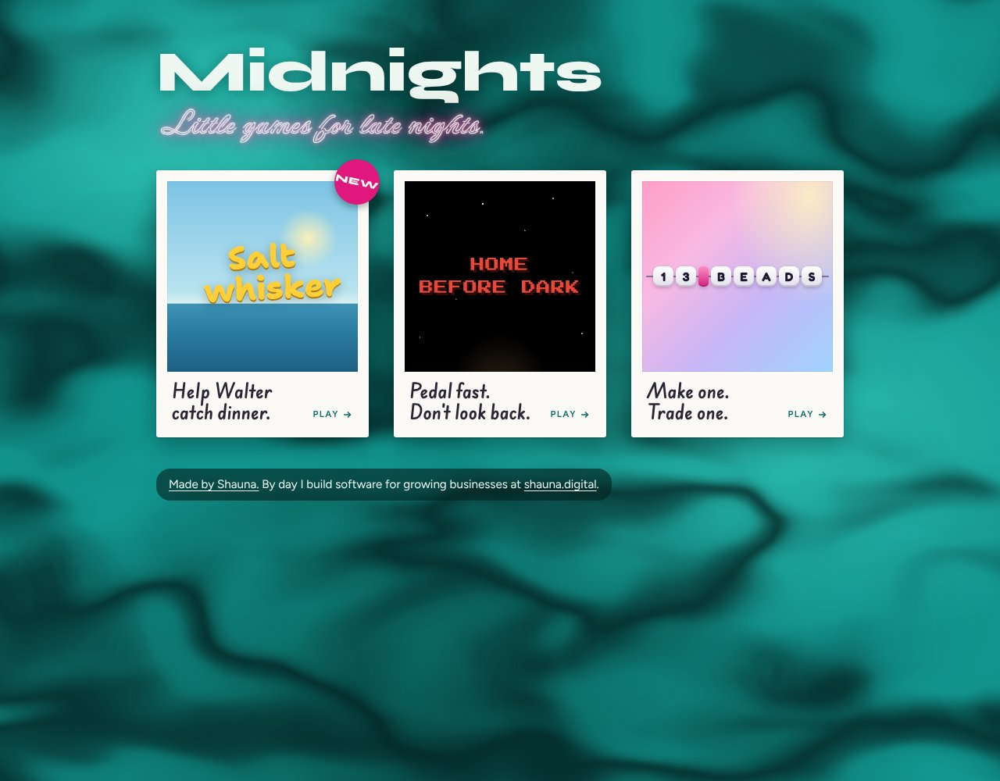

# Games

Little browser games for late nights. This repository is the home page that ties them together.

**▶ Play: [games.shauna.digital](https://games.shauna.digital)**

| Game | What it is |
|---|---|
| [13 Beads](https://games.shauna.digital/13-beads/) | String a friendship bracelet in 3D, spell a phrase, and hang it on your wall. ([repo](https://github.com/shaunagits/13-beads)) |
| [Home Before Dark](https://games.shauna.digital/homebeforedark/) | Pedal fast. Don't look back. |
| [Saltwhisker](https://games.shauna.digital/saltwhisker/) | A tuxedo cat in a yellow sou'wester fishes off a pier for his dinner. ([repo](https://github.com/shaunagits/saltwhisker)) |

## How it is set up

- This repository is a plain static site: `index.html` plus `vercel.json`. There is no build step and no framework.
- Hosting: Vercel project `games` (team `shaunagits-projects`), deployed automatically from the `main` branch. Pushing to `main` updates the live site.
- Domain: `games.shauna.digital` is attached to that Vercel project. DNS for `shauna.digital` is managed at Namecheap, where a CNAME record for the host `games` points to Vercel.
- Each game lives in its own repository and its own Vercel project. This site mounts a game under a path using a rewrite in `vercel.json`, so the game appears at `games.shauna.digital/<path>` without being copied here.

## Games mounted here

| Path | Repository | Vercel project | Address it forwards to |
|---|---|---|---|
| `/13-beads` | `shaunagits/13-beads` | `13-beads` | `https://13-beads.vercel.app` |
| `/homebeforedark` | `shaunagits/homebeforedark` | `homebeforedark` | `https://homebeforedark.vercel.app` |
| `/saltwhisker` | `shaunagits/saltwhisker` | `saltwhisker` | `https://saltwhisker.vercel.app` |

## Add a game

1. Deploy the game as its own Vercel project. It must use relative asset paths so it works under a subpath (for a Vite project, set `base: './'`).
2. In `vercel.json`, add three rules for its path. All three are needed:
   - a redirect from `/<path>` to `/<path>/`, so relative asset paths resolve correctly;
   - a rewrite for `/<path>/` itself (the wildcard rule does not match the bare folder path);
   - a rewrite for `/<path>/:path*`.
3. Add a card for it at the top of the list in `index.html`, linking to `/<path>/`, and move the "New" sticker to it.
4. Add a row to the table above.
5. Push to `main`, then check the home page, `/<path>`, and that the game's script files load.

## Things to know

- A game saves player data per web address. Data saved at a game's own `vercel.app` address does not appear at `games.shauna.digital/<path>`.
- Home page design (updated 2026-10-11): title "Midnights" in Syne, a flickering pink neon tagline "Little games for late nights." (Neonderthaw), straight polaroid game cards with handwritten teasers (Edu SA Hand) and a "Play" cue, newest game first with a "New" sticker, a hidden "Still developing." card ready for the next game, on a marbled teal background drawn in code. Colors and fonts are defined at the top of the `<style>` block in `index.html`.
- Link previews: `og.png` (1200 by 630) plus Open Graph and Twitter card tags in the page head. Regenerate the image when the cards change.
- All artwork is original. No artist names, logos, album artwork, or lyrics.

---

Built with ♥ by [shauna.digital](https://shauna.digital)
